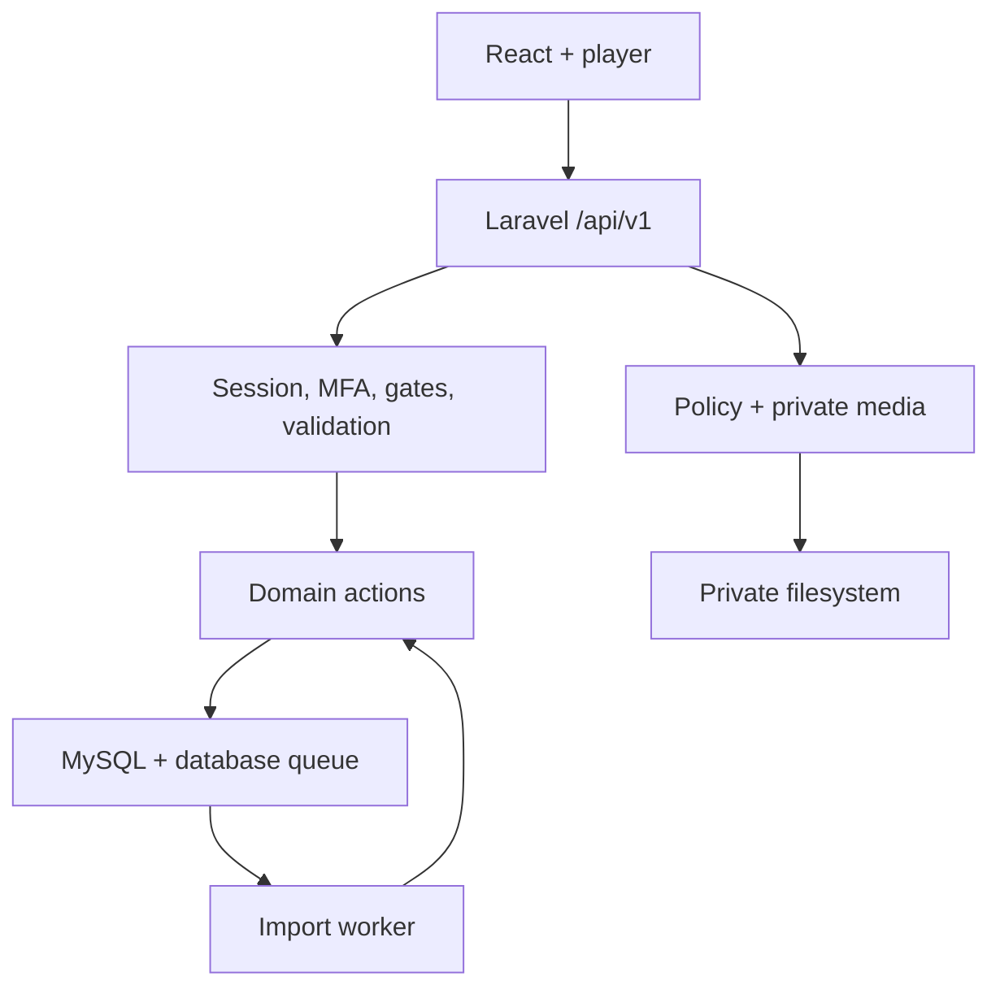

# معماری اجرایی ahang-khatkesh، نسخهٔ 0.2

## دامنه و انتخاب استک

این محصول کتابخانهٔ خصوصی برای مجموعاً ده حساب است. تعداد آهنگ با تعداد کاربر یکی نیست؛ محدودیت هر پلی‌لیست و هر manifest برابر ۵۰۰ آهنگ است. فایل باینری در دیسک خصوصی و هویت و رابطه‌ها در MySQL قرار دارند. این پروژه رتبه‌بندی جهانی یا گواهی امنیت ندارد؛ انتخاب‌ها، رفتار اجرایی و شواهد آزمون مبنای ارزیابی‌اند.

| لایه | انتخاب | مسئولیت |
| --- | --- | --- |
| اجرا | PHP 8.5 / Laravel 13 | هویت، مجوز، اعتبارسنجی، تراکنش، queue و ارائهٔ رسانه |
| داده | MySQL 8.4 LTS / InnoDB / utf8mb4 | مرجع یگانهٔ داده و صف؛ UTC |
| مدیریت DB | phpMyAdmin | ابزار جداگانهٔ اپراتور؛ جزئی از API یا runtime برنامه نیست |
| رابط | React 19 / TypeScript / Vite 8 | SPA فارسی، RTL و player مستقل از route |
| سرور state | TanStack Query | اطلاعات غیرمحرمانهٔ API و invalidation |
| کنترل رابط | Radix Dialog / Lucide / CSS معنایی | focus، تعاملات مشترک، تم و حرکت محدود |
| ورود | Laravel session / Fortify TOTP | CSRF، MFA، recovery و تأیید مجدد عملیات حساس |
| صوت | private filesystem / FFprobe | اعتبارسنجی محتوای واقعی و Range streaming |

Laravel می‌تواند با React، Vue یا Livewire کار کند. React در این پروژه به‌خاطر player ماندگار، قرارداد JSON صریح و زیست‌بوم طراحی انتخاب شده است. Inertia و Next.js برای این محصول خصوصی، مرز API درخواستی را ساده‌تر نمی‌کنند. یک پنل React مشترک، زبان کامپوننت و کنترل دسترسی یکسان دارد؛ Filament/Livewire به‌عنوان رابط دوم وارد نشده‌اند. Redis، Kubernetes، microservice و event sourcing برای مقیاس فعلی نیاز اجرایی ندارند.

## مرزها

| دامنه | محل اصلی | invariant |
| --- | --- | --- |
| هویت و مدیریت | UserRole، Permission، CreateUser، UpdateUserAccess، MFA | سقف ۱۰ حساب، حفظ آخرین مالک، ابطال نسخهٔ دسترسی |
| کاتالوگ | Artist، Release، Track و Actionهای Catalog | نام مشابه هویت یکسان نیست؛ فایل با اثر موسیقایی یکی نیست |
| پلی‌لیست | Playlist، UpdatePlaylist | ترتیب یکتا، عدم تکرار آهنگ، کنترل revision و بایگانی |
| ایمپورت | ManifestReader، PreviewPlaylistImport، RegisterTrack، PublishPlaylistImport | پیش‌نمایش بدون انتشار، idempotency و commit اتمیک |
| کتابخانهٔ شخصی | likes، saves، playback | دسترسی مطابق visibility و revision پخش |
| عملیات | overview، audit، operations، فرمان‌های CLI | گزارش محدود و ثبت رویداد بدون افشای credential |

## قرارداد لایه‌ها و الگوها

کنترلر، HTTP را هماهنگ می‌کند؛ FormRequest یا validation محدود ورودی را می‌سنجد. Action عملیات دارای invariant و تراکنش را نگه می‌دارد. Resource خروجی allowlist می‌سازد. Policy دسترسی صوت، کاور، جزئیات و علاقه‌مندی را هماهنگ می‌کند. Eloquent یک Active Record است؛ repository هم‌شکل CRUD بدون مرز جدید اضافه نشده است.

Parser Strategy برای JSON/CSV، Action برای عملیات دامنه، enum برای نقش و capability، optimistic concurrency برای ویرایش، queue job با idempotency برای ساخت و composition برای UI استفاده شده‌اند. نام «DDD» یا «CQRS» به تنهایی نشانهٔ کیفیت نیست؛ مرز واقعی، قرارداد و آزمون اهمیت دارد.

نوشتن‌های حساس ابتدا `library_settings.id=1` را در تراکنش تغییر می‌دهند؛ در MySQL قفل همان ردیف گرفته می‌شود. ترتیب قفل‌ها global سپس entity است. این تصمیم عمداً برای ده حساب ساده است؛ اندازه‌گیری contention، شرط تغییر آن است. queue روی همان دیتابیس/connection و داخل تراکنش درج می‌شود. انتقال به Redis یا دیتابیس دیگر به outbox یا طراحی تحویل جدید نیاز دارد.

## قرارداد خطا و تکامل

401 نشست نامعتبر؛ 403 مجوز ناکافی؛ 404 محتوای نامرئی؛ 409 revision یا idempotency متعارض؛ 419 CSRF؛ 422 ورودی نامعتبر؛ 423 تأیید مجدد؛ 428 الزام enrollment؛ 429 rate limit. فرانت فقط درخواست ردشده در middleware تأیید مجدد را پس از تأیید کاربر یک بار تکرار می‌کند.

migrationهای ۲۷ اکتبر به ساختار قبلی اضافه شده‌اند. شناسهٔ Track، لایک و عضویت پلی‌لیست حفظ می‌شود. فیلدهای artist/album روی tracks، projection نمایشی سازگار با API قبلی‌اند؛ هویت و اعتبار هنری در روابط نرمال‌شده‌اند. `is_admin` فقط سازگاری قدیمی است و مرجع مجوز نیست. تغییر migrationهای قبلی پس از انتشار مجاز نیست.

استقرار این نسخه ارتقای کنترل‌شده با maintenance و توقف worker می‌خواهد؛ migration حاوی backfill کوچک است و ادعای zero downtime ندارد. در MySQL، DDL کاملاً تراکنشی نیست؛ backup پیش از ارتقا و forward fix اهمیت دارد. افزایش بزرگ کاتالوگ، جداسازی backfill قابل‌ادامه از DDL را لازم می‌کند.

SQLite توسعه از WAL، busy timeout پنج ثانیه و transaction mode برابر IMMEDIATE استفاده می‌کند تا رقابت کوتاه worker/cache کمتر به خطای فوری قفل تبدیل شود. این تنظیم جایگزین آزمون همزمانی MySQL نیست؛ MySQL هدف محیط عملیاتی است.
