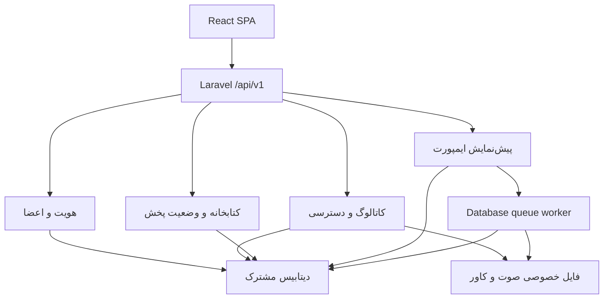

# معماری اجرایی

## انتخاب ساختار

یک برنامهٔ یکپارچه با مرزهای روشن دامنه و یک دیتابیس، اندازهٔ مناسب این محصول است. بخش‌های هویت، کاتالوگ، کتابخانهٔ شخصی، وضعیت پخش و ورود محتوا از نظر مسئولیت جدا هستند. کنترلرها ورودی HTTP را هماهنگ می‌کنند؛ عملیات دارای قانون دامنه در Action یا Service قرار دارند. پوشه‌بندی از قراردادهای Laravel پیروی می‌کند و هر ماژول به سرویس جداگانهٔ شبکه‌ای تبدیل نشده است.

## فناوری‌های انتخاب‌شده

| بخش | انتخاب | دلیل |
| --- | --- | --- |
| backend | Laravel 13 / PHP 8.5.x | session، CSRF، validation، policy، queue، migration و resources یکپارچه |
| رابط | React 19 / TypeScript | کامپوننت‌های قابل ترکیب و سازگاری با زیست‌بوم مرجع 21st.dev |
| state سرور | TanStack Query | cache، بازیابی، بارگذاری و invalidation پس از تغییر |
| state پخش | PlayerContext و توابع خالص صف | یک Audio، یک صف و کنترل مستقل از صفحه |
| فرم‌های پوششی | Radix Dialog | مدیریت focus، خروج با Escape و تلهٔ focus |
| استایل | CSS با token معنایی | هویت مستقل، RTL و دو پالت بدون وابستگی به تم آماده |
| توسعه/باندل | Vite و Laravel Vite | یک منبع frontend برای توسعه و استقرار |
| دیتابیس | SQLite برای شروع؛ MySQL 8.4 برای سرور پیشنهادی | نصب ساده و مسیر استاندارد استقرار؛ migration مشترک |
| صف | Database queue در همان دیتابیس برنامه | ثبت job و تغییر وضعیت import در یک تراکنش |
| رسانه | local private disk | فایل بیرون public و ارائه پس از policy |
| تشخیص صوت | FFprobe با آرگومان‌های ساختاریافته | مدت معتبر، وجود audio و محدودیت طول/نوع محتوا |

نسخه‌های دقیق قابل بازتولید در lockfileها هستند. نسخهٔ نصب‌شدهٔ این ساخت Laravel 13.38 و PHP 8.5.12 است.

## الگوها و محل استفاده

| الگو/روش | محل واقعی | اثر |
| --- | --- | --- |
| Action / use case | `CreateUser` و `PreviewPlaylistImport` | قوانین ظرفیت و پیش‌نمایش از HTTP مستقل‌اند |
| Strategy | `ManifestParser`، JSON و CSV parser | افزودن قالب ورودی بدون تغییر مسیر انتشار |
| Adapter | `PrivateMedia` و disk لاراول | جداکردن مسیر و ارائهٔ فایل از کنترلر |
| Policy | `PlaylistPolicy` و `TrackPolicy` | دسترسی یکسان جزئیات، صوت، کاور و لایک |
| Active Record | مدل‌های Eloquent و scopeها | روابط و queryهای قابل خواندن با قرارداد Laravel |
| Job و عملیات idempotent | `PublishPlaylistImport` | اجرای دوبارهٔ worker، پلی‌لیست دوم ایجاد نمی‌کند |
| تراکنش و قید یکتایی | schema و Actionها | حفاظت از رابطه‌ها و جلوگیری از ثبت نصفه |
| optimistic concurrency | `PlaybackState.revision` | وضعیت قدیمی به وضعیت جدید غلبه نمی‌کند |
| component composition | UI، Music و صفحه‌ها | کنترل‌های یکسان و رفتار قابل استفادهٔ مجدد |
| state مرکزی پخش | `PlayerProvider` | Audio از routeهای صفحه مستقل است |

برای Eloquent لایهٔ repository با متدهای هم‌نام CRUD اضافه نشده است؛ مرزهای واقعی فعلی، parser و رسانه‌اند. State پخش با state/context پیاده شده و کلاس‌های جداگانه برای هر حالت ندارد. خواندن و نوشتن مسیرهای مشخص دارند و CQRS زیرساختی یا event sourcing در این نسخه وجود ندارد.

## چرخهٔ درخواست

تمام APIها زیر web middleware و prefix نسخه‌دار اجرا می‌شوند. session، CSRF، احراز هویت، فعال بودن حساب و در بخش مدیر Gate اجرا می‌شوند. FormRequest داده و مجوز را می‌سنجد. کنترلر Action/Service را فراخوانی و Resource یک خروجی محدود تولید می‌کند. نام فایل داخلی، رمز و remember token در resource عمومی قرار نمی‌گیرند. فرانت‌اند bearer token در localStorage ندارد.

## قفل‌های دامنه

پیش از شمارش کاربر، ساخت import و ذخیرهٔ revision، نوشتن کوچک روی `library_settings.id=1` انجام می‌شود. این کار در SQLite قفل نوشتن و در MySQL قفل ردیف می‌گیرد. برای این اندازهٔ محصول، سری‌سازی نوشتن‌های حساس قابل فهم و عملی است. transactionها retry محدود دارند. اعتباردهی role و سقف حساب فقط از مسیرهای برنامه تضمین می‌شود؛ نویسندهٔ SQL مستقیم می‌تواند قانون برنامه را دور بزند و باید تنها از عملیات مدیریت‌شده استفاده کند.

ساخت job روی connection نوع database و داخل همان تراکنش انجام می‌شود. worker باید به همان دیتابیس متصل باشد؛ استفاده از queue در دیتابیس جدا یا Redis نیازمند تصمیم جدید دربارهٔ outbox است. timeout اجرای job برابر 120 ثانیه و retry_after برابر 180 ثانیه است.

## ارائهٔ فایل

`StreamController` پس از policy از BinaryFileResponse استفاده می‌کند. Range، HEAD و طول پاسخ را لایهٔ HTTP مدیریت می‌کند. مسیر فایل واقعی باید داخل root خصوصی باشد. فایل کامل در حافظهٔ PHP خوانده نمی‌شود. کاور نیز endpoint داخلی محافظت‌شده دارد. در استقرار اولیه، FPM زمان انتقال را مصرف می‌کند؛ انتقال با X-Accel پس از احراز هویت، توسعهٔ بعدی برای بهینه‌سازی این مسیر است.

## مرزهای خطا

خطای اعتبارسنجی 422، فقدان نشست 401، نقش نامجاز 403، محتوای غیرقابل مشاهده 404 و تعارض revision یا idempotency برابر 409 است. وضعیت‌های UI خطا، انتظار و retry دارند. APP_DEBUG باید در سرور false باشد؛ اطلاعات عملیاتی در لاگ سرور و audit ذخیره می‌شود.
