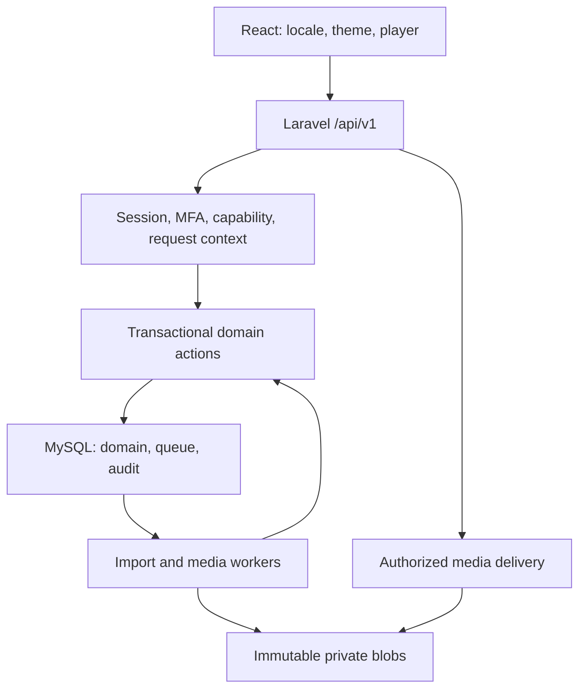
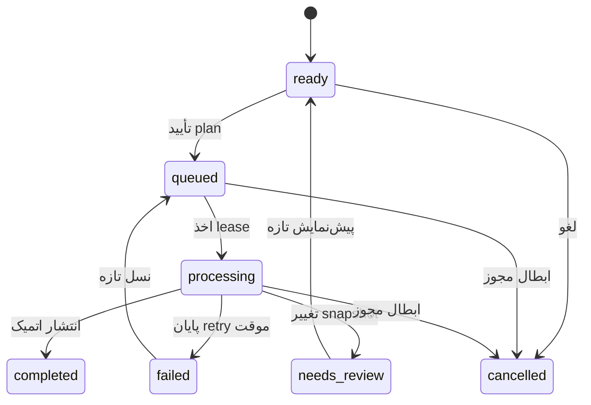

# معماری هدف 0.3؛ قرارداد پیاده‌سازی

> به‌روزرسانی: این سند سابقه/طرح نسخهٔ قبلی است. وضعیت اجرایی و مجوزهای تازه در [بازبینی جاری](CURRENT_REVIEW.fa.md) و ترتیب کار و شواهد در [رودمپ ۱۶ فازی](ROADMAP.fa.md) مشخص شده‌اند. در تعارض مجوزها، کاتالوگ فقط در اختیار سوپرادمین است.

وضعیت: design target، ۲۷ اکتبر ۲۰۲۶. runtime مخزن همچنان 0.2 است. این سند قراردادهای اصلاحی [بازبینی](ARCHITECTURE_REVIEW.fa.md) را مشخص می‌کند؛ ایجاد جدول، endpoint، worker یا component ذکرشده به معنی پیاده‌شدن آن نیست. [blueprint.json](architecture/blueprint.json) فهرست ساختاری و [نقشهٔ اجرا](IMPLEMENTATION_ROADMAP.fa.md) وضعیت تحویل را نگه می‌دارند.

## استک و مرز اعتماد

PHP 8.5، Laravel 13، MySQL 8.4/InnoDB/utf8mb4 و React 19/TypeScript/Vite حفظ می‌شوند. نسخهٔ نصب‌شده از lockfile خوانده می‌شود؛ ارتقا از مسیر audit و CI انجام می‌شود. UI عمومی و ادمین یک سیستم کامپوننت دارند؛ پنل به‌صورت lazy بارگذاری می‌شود. تمام عملیات تجاری، authorization و انتخاب رسانه در `/api/v1` لاراول است. مرورگر به DB، phpMyAdmin یا FFmpeg دسترسی مستقیم ندارد. Nginx فقط پس از مجوز Laravel، فایل private را از location داخلی تحویل می‌دهد.

## مسئولیت ماژول‌ها

| مرز | مسئولیت و مالک invariant | الگوی مناسب |
| --- | --- | --- |
| Identity | ظرفیت ۱۰ حساب شامل غیرفعال، آخرین owner، epoch، MFA و step-up | Action تراکنشی + Fortify + capability |
| Catalog | Artist/Release/Track، credit، اصل ضبط و projection سازگار | Action مرجع ثبت/ویرایش؛ FK و revision |
| Playlists | visibility، ترتیب ۱ تا n، revision و archive | Policy + optimistic concurrency |
| Imports | parse، effective plan، تأیید و انتشار اتمیک | Parser Strategy + generation/lease |
| Media | blob، asset، rendition، تبدیل، quota و GC | Process adapter + state machine + immutable publish |
| PersonalLibrary | likes، saves، playback و account-scoped cache | API همان مبدأ + revision |
| Operations | audit، heartbeat، readiness، backup/restore | دادهٔ محدود و runbook قابل اجرا |

کنترلر HTTP را هماهنگ می‌کند، FormRequest ورودی و Resource خروجی allowlist می‌سازد. Action مرز تراکنش و قاعدهٔ کسب‌وکار است. قرارداد adapter فقط برای filesystem/process لازم است؛ repository عمومیِ هم‌شکل Eloquent، لایهٔ CQRS بدون نیاز و پوشه‌های خالی اضافه نمی‌شوند. استخراج پوشه‌های ماژول به‌تدریج و همراه تغییر رفتار انجام شود؛ جابه‌جایی انبوه کلاس‌های موجود هدف نیست.

## نوشتن معتبر در لحظهٔ اجرای واقعی

قفل فعلی `library_settings.id=1` برای نوشتن‌های کم‌تعداد حساس حفظ می‌شود. ترتیب: global، سپس User، entityها به ترتیب شناسه، import/conversion و اشاره‌گرها. credential hashing، FFprobe، FFmpeg و I/O طولانی بیرون این تراکنش‌اند. درون قفل، actor تازه، epoch مورد انتظار، مجوز فعلی، revision و مالکیت media مجدد بررسی می‌شوند. یک mutation با User موجود در request نباید اعتبار snapshot را مفروض بگیرد.

Action باید مستقل از HTTP و job همان invariant را اعمال کند. خطای ownership، revision یا مجوز، domain error دائمی است؛ retry صف آن را درست نمی‌کند. خطای موقت اتصال/دیسک با backoff محدود جداگانه retry می‌شود. audit و queue write باید روی همان SQL connection در همان تراکنش نوشته شوند. پس از commit فقط housekeeping غیرحیاتیِ بدون نیاز به تحویل قابل اعتماد می‌تواند callback موقت باشد؛ حذف فایل مرجع‌دار از این جنس نیست.

## مدل دادهٔ هدف و تکامل

| موجودیت | قرارداد |
| --- | --- |
| Artist و Release | هویت با ID؛ نام مشابه مجاز؛ primary credit و ترتیب معتبر؛ rename، revision و projection وابسته را به‌روز کند |
| Track | هویت recording با ID ثابت؛ likes/playlist آن حفظ شوند؛ primary_release عضو release_track خودش باشد |
| MediaAsset | هویت منطقی فایل برای یک recording؛ اصل یا مشتق؛ UUID فعلی حفظ شود؛ path خصوصی serialize نشود |
| MediaBlob جدید | بایت immutable؛ SHA-256 یکتا، key داخلی یکتا، bytes، MIME/probe و lifecycle؛ یک blob می‌تواند پشت چند asset منطقی باشد |
| track_media | هر asset متعلق به یک Track؛ label یکتا در Track؛ همان اصل tracks.media_asset_id نیز در رابطهٔ original ثبت شود |
| MediaConversion جدید | source، profile/version، generation/lease، وضعیت، output و provenance؛ فقط خروجی اعتبارسنجی‌شده ready شود |
| Import | ورودی خامِ محدود، plan مؤثر، hash، revisionهای وابسته، generation، lease و playlist نهایی |
| User preferences | locale، time_zone و theme با allowlist؛ direction مستقل از متن و از locale config؛ credential در این تنظیمات قرار نگیرد |

تفاوت blob و asset ضروری است: دو تبدیل از ضبط‌های متفاوت می‌توانند بایت یکسان تولید کنند؛ SHA نباید به ادغام هویت ضبط یا تصاحب rendition منجر شود. unique فعلی media_assets.sha256 تا پایان expand/backfill/verify و cutover حذف نمی‌شود. مسیر API قدیمی برای آپلود دقیقاً تکراری همچنان asset حاصل از آپلود canonical را برمی‌گرداند؛ قرارداد سازگاری با ستون nullable و unique به نام canonical_upload_blob_id طراحی می‌شود. در asset حاصل از آپلود canonical مقدار آن برابر blob_id است؛ در مشتق تولیدشده null. این فیلد، منشأ upload را مشخص می‌کند و با purpose=original/rendition در Track یکی نیست؛ فایل rendition آپلودشدهٔ دستی نیز می‌تواند canonical upload باشد. قید CHECK این برابری و FKها را می‌سنجد؛ unique روی nullable، یک canonical upload برای هر blob و چند مشتق معنایی را ممکن می‌کند. SHA/path قدیمی پس از cutover فقط projection خواندنی و در contract بعدی قابل حذف‌اند؛ دو مرجع مستقل قابل نوشتن نمانند.

نام نمایشی NFC و plain text است؛ ZWNJ و نوشتار فارسی حفظ شوند. نرمال‌سازی جستجو جدا و versioned باشد. عنوان پلی‌لیست ۱ تا ۱۶۰ و عنوان/هنرمند ۱ تا ۲۵۵ نویسه، مطابق قرارداد v1، باقی می‌مانند؛ truncation بی‌صدا مجاز نیست. نام فایل، slug یا عنوان، کلید هویتی یا مسیر storage نیست. SQL با binding و ترتیب دارای tie-breaker اجرا شود. country/language tag با locale رابط یکی نیست. کاراکتر کنترلی bidi در شناسه و نام فایل برای نمایش امن خنثی شود؛ متن هنری سالم با قاعدهٔ بیش‌ازحد محدود نشود.

## ایمپورتِ قابل اعتماد

پیش‌نمایش، فایل خارجی را اجرا یا دانلود نمی‌کند؛ JSON/CSV محدود و asset_id داخلی می‌پذیرد. plan شامل source_hash، plan_version، plan_hash، ترتیب، تصمیم create/reuse، شناسه و revision هویت‌های انتخاب‌شده، fingerprint اصل و متادیتای نهایی نمایش‌داده‌شده است. Track بازاستفاده‌شده با metadata موجود نمایش داده می‌شود؛ برچسب ردیف ورودی جای نتیجهٔ واقعی را نمی‌گیرد. انقضای plan در UI معلوم است؛ هر تغییر مؤثر نیازمند پیش‌نمایش تازه و تأیید دوباره است.

تعهد commit به plan_hash، revision و publish انتخاب‌شده متصل است. ثبت status و job اتمیک است. generation در payload job و شرط تمام updateها، از جمله failed، وجود دارد. تلاش framework همان generation را نگه می‌دارد؛ retry صریح پس از terminal failure، generation تازه می‌سازد. reconciler، lease منقضی را تحت قفل و audit بررسی می‌کند و حداکثر یک بار دوباره زمان‌بندی می‌کند. serialized jobs.payload مرجع حقیقت دامنه نیست.

لغو حین اجرا با generation/fencing کنترل می‌شود. انتشار نهایی دوباره imports.manage و وضعیت فعال سازنده را بررسی می‌کند؛ پس‌گرفتن مجوز اجازهٔ انتشار job قدیمی نمی‌دهد. completed پلی‌لیست دوم نمی‌سازد. failed قدیمی حق تغییر نسل جدید را ندارد. نیازهای تبدیلِ تعیین‌شده برای انتشار باید پیش از ورود به تراکنش انتشار ready باشند؛ FFmpeg در قفل اجرا نمی‌شود.

## فایل، کاور و فضای ذخیره‌سازی

پروتکل مشترک: رزرو ظرفیت، نوشتن خصوصی با key تصادفی، اعتبارسنجی و hash، انتقال اتمیک در همان filesystem به key immutable، سپس commit اشاره‌گر و job پاک‌سازی در DB. فایل unreferenced در اثر crash قابل GC است. بعد از خطای مبهم commit، حذف فوری ممنوع؛ بررسی مرجع یا GC با تأخیر انجام شود. blob در وضعیت deleting قابل claim نیست؛ هنگام GC همهٔ attachها همان قفل lifecycle را رعایت کنند تا فاصلهٔ بررسی تا حذف، مالکیت تازه نسازد.

quota هم committed bytes و هم reservationهای معتبر را حساب می‌کند؛ minimum free space جداست. اصل‌ها، conversionهای جاری، planهای معتبر، اشاره‌گرها و snapshot backup مرجع محافظ هستند. dry-run و دورهٔ نگهداری پیش از حذف لازم‌اند. فایل FLAC اصلی خودکار حذف نمی‌شود. قرارداد دقیق مشتق‌سازی در [MEDIA_PIPELINE](MEDIA_PIPELINE.fa.md) است.

## فرانت و قرارداد API

Providerهای locale/theme/session/player بالای route هستند. UI از [قرارداد universal](UNIVERSAL_UI.fa.md) و [کاتالوگ کامپوننت](COMPONENT_CATALOG.fa.md) پیروی می‌کند. schema OpenAPI مرجع typeهای شبکه است؛ stateهای draft/audio نوع مستقل دارند. ترجمهٔ message، کد ماشینی خطا را تغییر نمی‌دهد. خطا شامل code، message، errors، request_id و فقط در تعارض، revision غیرمحرمانهٔ مرتبط باشد. پاسخ و خطا با schema و allowlist تست شوند.

هر intent تغییر داده، actorId، accessVersion و generation محلی session را ضبط می‌کند. 419/423 فقط اگر همان context تأیید شود یک بار retry می‌شود؛ switch حساب، intent را رد و cache/queue شخصی را پاک می‌کند. BroadcastChannel کمک هماهنگی است؛ سرور همچنان مرجع مجوز است. precondition actor سمت سرور، در صورت پیاده‌سازی، جای authorization را نمی‌گیرد. رمز و OTP در cache، log، analytics یا storage پایدار قرار نمی‌گیرند.

فرم ویرایش، ServerSnapshot/baseRevision/EditableDraft/dirty را جدا نگه می‌دارد؛ دریافت دادهٔ جدید هنگام dirty فقط remoteUpdateAvailable را نشان می‌دهد. conflict، draft را حفظ می‌کند. debounce واقعی ۲۵۰ms و AbortSignal برای جستجو؛ useDeferredValue جای debounce نیست. AbortError پیام قطع اینترنت تولید نکند. Query key دادهٔ شخصی به حساب وابسته و invalidation با entity/revision محدود باشد. stream و recovery cache عمومی یا service worker ندارند.

## امنیت، عملیات و معیار تحویل

قابلیت‌ها و Fortify حفظ می‌شوند. step-up و recovery به نرخ حساب و نرخ IP جداگانه محدود شوند. cookie امن با TLS، CSP محدود و رسانهٔ private، اصل پایه‌اند. phpMyAdmin فقط روی مسیر اپراتور محدود، با credential مستقل؛ حساب runtime مجوز DDL ندارد. لاگ‌ها credential، path، فایل manifest کامل یا محتوای recovery را نگه ندارند. retention audit و فایل‌های موقت باید قابل تنظیم و در runbook باشد.

DDL MySQL با rollback معمولی undo نمی‌شود؛ migration قدیمی تغییر نکند. ارتقای 0.2 موجود با maintenance، توقف worker و snapshot قابل بازیابی انجام شود. migration جدید به expand، backfill قابل ادامه، verify و contract تقسیم شود. backup شامل snapshot DB، manifest دقیق blobهای immutable، کلیدهای رمزگشایی نسخه‌دار، app commit و schema version است. GC تا پایان کپی همان manifest مانع نگهداری دارد؛ restore در محیط ایزوله و با hash و MFA آزمایش شود.

اهداف اولیه، اندازه‌گیری‌نشده: ۱۰ حساب، ۱۰ شنوندهٔ همزمان، ۵۰۰ ردیف هر پلی‌لیست/import؛ تست metadata با ۱۰هزار Track مصنوعی. روی سخت‌افزار ثبت‌شده و شبکهٔ هم‌منطقه، p95 پاسخ JSON حداکثر ۵۰۰ms و first byte صوت حداکثر ۱s، همزمان با دو درخواست مدیریت در ثانیه، طی ۱۵ دقیقه هدف آزمون است. این عددها SLA یا نتیجهٔ واقعی نیستند. RPO≤24h و RTO≤4h نیز تا restore واقعی فقط هدف‌اند. اندازه، codec، bitrate و وضعیت دیسک fixtureها باید گزارش شوند.

readiness، heartbeat worker، قدیمی‌ترین job، lease منقضی، فضای آزاد/reserved، backup age و آخرین restore موفق پایش شوند؛ `/up` صرفاً liveness است. ASVS 5 سطح ۲ و WCAG 2.2 AA هدف کنترل‌اند؛ تأیید نهایی با mapping کنترل به شاهد، مرورگر واقعی، آزمون همزمانی MySQL، بار، restore و بازبینی مستقل انجام می‌شود. هیچ مورد «planned» با نوشتن این سند به «verified» تبدیل نشده است.

مراجع تصمیم‌های حساس: [OWASP: کنترل نهایی عملیات](https://cheatsheetseries.owasp.org/cheatsheets/Transaction_Authorization_Cheat_Sheet.html)، [MySQL 8.4: implicit commit](https://dev.mysql.com/doc/refman/8.4/en/implicit-commit.html)، [Nginx: X-Accel-Redirect در FastCGI](https://nginx.org/en/docs/http/ngx_http_fastcgi_module.html#fastcgi_ignore_headers)، [TanStack Query: پیش‌فرض‌های refetch](https://tanstack.com/query/latest/docs/framework/react/guides/important-defaults). قراردادهای دامنه و بودجه‌ها، تصمیم طراحی این پروژه‌اند.
