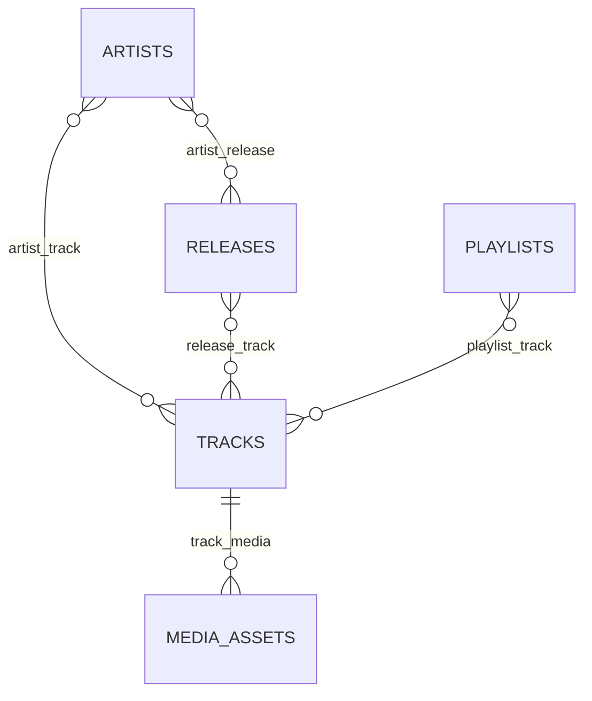

# مدل داده و قواعد یکپارچگی

ساختار زیر متعلق به runtime نسخهٔ 0.2 است. [بازبینی](ARCHITECTURE_REVIEW.fa.md) تضاد ممکن مالکیت original/rendition را بازتولید کرده است؛ نوشتن یک قاعده در این سند، اثبات enforce شدن تمام مسیرها نیست. جداسازی media_blobs از media_assets، conversion/reservation و backfill مرحله‌ای، قرارداد هدف [معماری 0.3](ARCHITECTURE_TARGET.fa.md) و [رسانه](MEDIA_PIPELINE.fa.md) هستند و هنوز migration اجرایی ندارند.

مرجع ساختار، migrationهای نسخه‌بندی‌شده است. MySQL 8.4 با InnoDB، utf8mb4 و UTC هدف است. phpMyAdmin فقط ابزار مشاهده و عملیات اپراتور است. صوت در BLOB دیتابیس ذخیره نمی‌شود.

در نمودار، رابطه‌ها مفهومی‌اند؛ جدول‌های واسط زیر قیدهای واقعی را دارند.

| جدول | کلید و ستون‌های مهم | قاعده |
| --- | --- | --- |
| users | bigint id، email unique، role enum، access_version، is_active | owner/administrator/curator/listener؛ ده حساب شامل غیرفعال‌ها |
| users: MFA | secret و recovery_codes از نوع TEXT رمز‌شده، confirmed_at | API عمومی آن‌ها را serialize نمی‌کند |
| library_settings | id=1، lock_version | نقطهٔ سری‌سازی عملیات محدود دامنه |
| artists | bigint id، name، sort_name، description، country_code، provenance unique nullable، revision | name عمداً unique نیست؛ هم‌نامی دلیل ادغام نیست |
| releases | bigint id، title، type، released_on، provenance، revision | album/single/ep/compilation؛ عنوان تکراری مجاز |
| artist_track | track_id + artist_id + role، position | primary/featured/composer/producer؛ نقش تکراری برای یک هنرمند ممنوع |
| artist_release | release_id + artist_id، position unique در انتشار | اعتبار هنرمندان به ترتیب مشخص |
| release_track | release_id + disc_number + track_number؛ release_id + track_id unique | یک ضبط در چند انتشار؛ شمارهٔ هر دیسک یکتا |
| tracks | bigint id، title، primary_release_id، media_asset_id unique، catalog_revision | اثر/ضبط و رسانه جدا؛ artist/album projection سازگاری |
| media_assets | UUID، sha256 unique، path خصوصی، MIME، bytes، duration، uploaded_by | dedup باینری؛ نام فایل اصلی هویت یا مسیر فایل نیست |
| track_media | track_id + media_asset_id؛ asset unique؛ track_id + label unique | original/rendition؛ فایل یک نسخه به یک ضبط تعلق دارد |
| playlists | bigint id، name ≤160، mood، status، revision، created_by | draft/published/archived؛ نام هویت نیست |
| playlist_track | playlist_id + track_id؛ playlist_id + position unique | ترتیب پیوستهٔ یک‌مبنایی؛ تکرار Track در همین پلی‌لیست v1 ممنوع |
| playlist_imports | UUID، created_by + idempotency_key unique، payload_hash، JSON rows | ready/processing/completed/failed؛ گزارش و مرجع پلی‌لیست |
| liked_tracks / saved_playlists | user_id + related_id composite primary | دادهٔ شخصی؛ رابطهٔ تکراری ساخته نمی‌شود |
| playback_states | user_id unique، track_id nullable، JSON queue، revision | وضعیت شخصی با conflict 409؛ queue در Action اعتبارسنجی می‌شود |
| audit_events | bigint id، actor nullable، action، subject، request_id، metadata | ایجاد رویداد؛ serialization محدود و cursor pagination |
| sessions / jobs / failed_jobs / cache | زیرساخت Laravel | session و queue در DB؛ migration حساب جدا از runtime |

## هویت و مهاجرت اطلاعات قبلی

هر Track همان شناسهٔ قبلی را نگه می‌دارد. backfill از artist/album متنی، هنرمند و انتشار دارای provenance مربوط به همان Track می‌سازد. متن یکسان به‌تنهایی شناسهٔ مشترک نمی‌سازد؛ ممکن است موارد نیازمند بازبینی تکراری دیده شوند. curator با ویرایش اعتبار هنری، شناسهٔ درست را انتخاب می‌کند. `artist_id` و `release_id` اختیاری در manifest جدید، امکان استفادهٔ صریح از هویت موجود را می‌دهند. متادیتای Track مشترک موجود هنگام import تغییر نمی‌کند.

Track می‌تواند در چند Release باشد؛ `primary_release_id` انتشار نمایشی اصلی را مشخص می‌کند و باید در فهرست release_track آن Track باشد. عنوان آلبوم یا نام هنرمند آزاد، جای کلید خارجی را نمی‌گیرد. تغییر نام هنرمند یا انتشار از Actionهای کاتالوگ، projection و revisionهای وابسته را هم به‌روز می‌کند.

## حذف، بایگانی و فایل‌ها

رابط حذف فیزیکی حساب یا Track ندارد. حساب غیرفعال و پلی‌لیست بایگانی می‌شود؛ بایگانی از دید شنونده و ارائهٔ صوت/کاور خارج است، مگر Track در پلی‌لیست منتشرشدهٔ دیگری باشد. حذف عضو/اثر با SQL مستقیم می‌تواند تاریخچه و قانون برنامه را بشکند. FKهای restrict/cascade/nullOnDelete متناسب با مالکیت در migrationها مشخص‌اند.

رسانهٔ اصلی همان media_asset_id سازگار قبلی است و در track_media هم ثبت می‌شود. API ثبت rendition، مدت را با اصل مقایسه و اتصال مجدد فایل را رد می‌کند. تشخیص اینکه دو فایل واقعاً یک اجرای موسیقایی‌اند همچنان به اپراتور مربوط است؛ مدت برابر اثبات هویت نیست. انتخاب خودکار codec، transcoding و UI مدیریت rendition در این نسخه تکمیل نشده‌اند؛ پلیر نسخهٔ اصلی را پخش می‌کند.

## همزمانی و ایندکس‌ها

ویرایش Track، Artist، Release و Playlist نیازمند revision جاری است. بازنویسی کور با 409 رد می‌شود. جایگزینی ترتیب پلی‌لیست در تراکنش detach/attach می‌شود تا قید موقعیت یکتا نقض نشود. likes و شناسهٔ فایل حفظ می‌شوند.

کلیدهای FK و compositeها برای join و ترتیب‌اند؛ status,id برای کتابخانه و action,id برای audit وجود دارند. جستجوی فعلی `LIKE` پارامتری روی search_text نرمال‌شده است؛ B-tree آن را برای `%term%` سریع نمی‌کند. برای کاتالوگ بزرگ، EXPLAIN با دادهٔ واقعی و سپس FULLTEXT یا موتور جستجو تصمیم بعدی است. تعداد کاربر کم، معادل تعداد آهنگ کم نیست.

backup باید schema، داده، فایل‌های خصوصی و APP_KEY را پوشش دهد. export دیتابیس بدون کلید رمزگشایی MFA و بدون فایل‌ها بازیابی کامل نیست. rollback ساختاری کاتالوگ دادهٔ جدید روابط را حذف می‌کند؛ در محیط عملیاتی forward fix با backup ارجح است.

## دادهٔ شنیدن F11

migration جدید، شش فیلد کنترل رضایت/پیشنهاد/retention/revision/private-until/consent-at را به users و جدول listening_events با UUID و ایندکس user_id/started_at/id اضافه می‌کند. FKهای user و track حذف وابسته دارند. session_pseudonym فقط HMAC است؛ IP و session ID خام ذخیره نمی‌شوند. حد ۱۰٬۰۰۰ ردیف در هر حساب و retention پیش‌فرض سی روز با حذف زمان‌بندی‌شده برقرار است. erase و افزایش revision اتمیک‌اند و مجوزهای قدیمی را باطل می‌کنند. جزئیات در [قرارداد F11](F11_LISTENING_PRIVACY.fa.md) است.

## کاتالوگ و پیشنهاد F12

`tracks.recording_identity` و `recording_provenance` nullable هستند و خودکار پر نمی‌شوند. `merged_into_id` کلید خارجی restrict به همان جدول است؛ ادغام، ردیف ضبط قبلی را حذف نمی‌کند. `member_proposals` کلید UUID، FK فرستنده، access_version اولیه، idempotency key یکتا در هر کاربر، hash، payload، snapshot و نتیجهٔ بررسی دارد. `catalog_change_sets` journal مقید به actor/version، scope، before/after، revision، hash و مهلت‌های پیش‌نمایش/بازگردانی است. روابط شخصی در snapshot کپی نمی‌شوند.

در undo، revision افزایش می‌یابد و موقعیت قدیمی playlist/credit حفظ می‌شود. محتوای journal از API به‌صورت allowlist محدود به summary و نتیجه ارائه می‌شود. indexهای user/date/id و status/date/id برای صفحه‌بندی و inbox هستند. جدول proposal و journal جای رسانه یا backup را نمی‌گیرند. جزئیات [قرارداد F12](F12_CATALOG_WORKFLOWS.fa.md) مقدم است.
