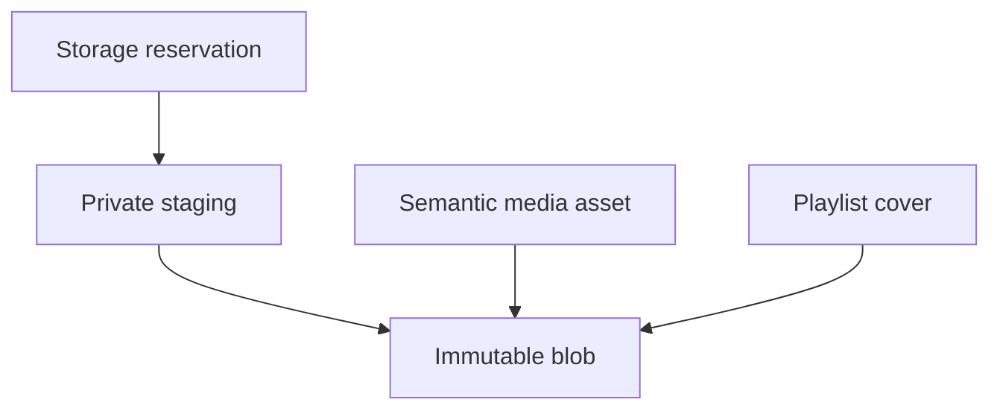
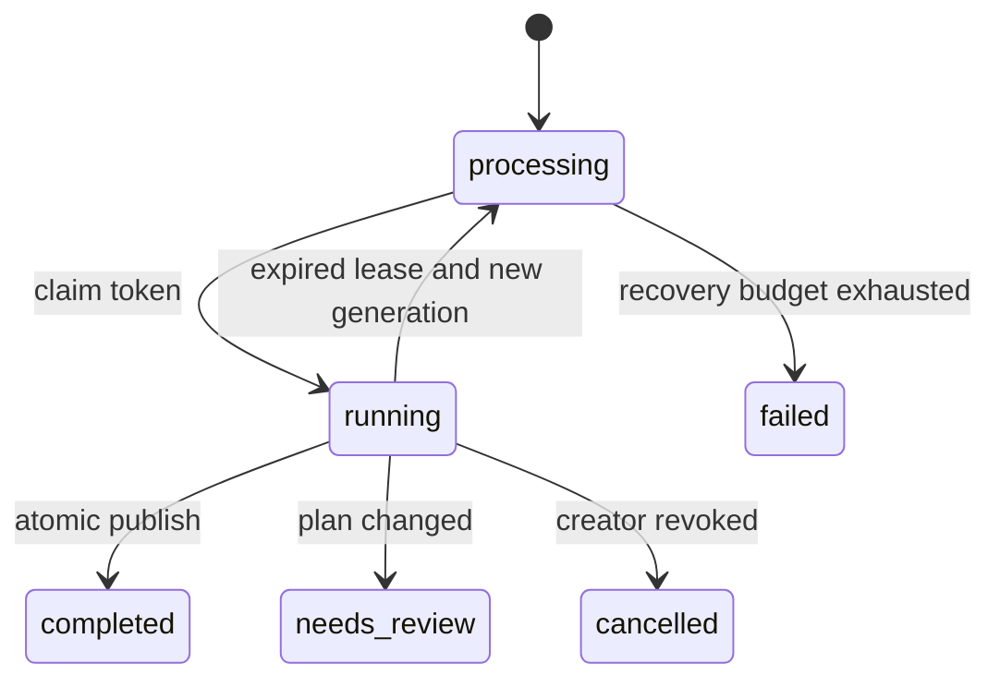

# F07 — ذخیره‌سازی بادوام و بازیابی پردازش

تاریخ: ۲۸ اکتبر ۲۰۲۶، Asia/Tehran. مبنا: commit `7da7ddc118d585fe06bbeebae9910ca264271edc`. این سند قرارداد اجرایی F07 است. نتیجهٔ آزمون و تیک تأیید از [رودمپ](ROADMAP.fa.md) و evidence همان SHA خوانده می‌شود؛ وجود این سند تأیید production نیست.

## نقص‌های واقعی و اصلاح

| شناسه | رفتار قبلی یا ایراد کشف‌شده | اصلاح | تست پذیرش |
| --- | --- | --- | --- |
| F07-B01 | سقف مجموع وجود نداشت؛ هر فایل معتبر تا ۱۰۰ MiB پذیرفته می‌شد، حتی اگر جمع آن‌ها از ظرفیت مطلوب عبور می‌کرد | رزرو پیش‌پرواز، قفل global، سقف بایت و headroom فیزیکی | MediaBlobQuotaTest و دو process روی MySQL |
| F07-B02 | job کشته‌شده می‌توانست برای همیشه processing بماند | queued/running مجزا، token و generation، heartbeat، lease و reconciliation | ImportLeaseRecoveryTest و kill واقعی queue worker |
| F07-B03 | unique بودن sha روی asset، بایت یکسان را با هویت رسانه یکی می‌کرد | blob فیزیکی یکتا بر sha+size؛ چند asset مستقل می‌توانند آن را ارجاع دهند | دو آپلود هم‌زمان با asset مستقل و blob مشترک |
| F07-B04 | شکست مبهم DB یا پایان retry می‌توانست فایل بی‌ارجاعِ بدون مسیر بازیابی باقی بگذارد | مسیر staging/candidate پیشاپیش ثبت می‌شود؛ cleanup retry و maintenance و GC با retention | تزریق disk full، staging صفر بایت و rollback کاور |
| F07-B05 | انقضای مهلت به‌تنهایی ثابت نمی‌کند نویسندهٔ فایل متوقف شده است | قفل filesystem مستقل و nonblocking؛ هر writer پس از گرفتن قفل دوباره lease DB را می‌سنجد | cleanup هنگام نگه‌داشتن flock رد می‌شود |
| F07-B06 | اتکا به affected rows در تمدید فوری heartbeat روی MySQL می‌تواند تمدید معتبر را شکست‌خورده نشان دهد | match و lock ردیف، سپس update؛ موفقیت بر اساس اعتبار fence است | تمدید فوری و تمدید پس از گذشت زمان |
| F07-B07 | payload قدیمی queue ممکن است property جدید token را اصلاً مقداردهی نکرده باشد | payload بدون token معتبر هیچ اثر انتشار ندارد؛ reconciler قرارداد تازه می‌سازد | ساخت job بدون constructor و آزمون عدم انتشار |
| F07-B08 | باقی‌ماندن guard file و پوشهٔ staging پس از پایان upload به مرور inode مصرف می‌کرد | پوشهٔ خالی در promote/cleanup حذف و lockهای terminal پس از retention prune می‌شوند | آزمون حفظ رسانه و حذف lock terminal |
| F07-T01 | فایل SQLite/WAL مرورگر در مسیر همگام‌شوندهٔ workspace خراب شد و پاسخ‌های 500 و توقف تست ایجاد کرد | DB و رسانهٔ هر اجرای مرورگر در پوشهٔ UUID مجزا در temporary directory سیستم قرار می‌گیرند؛ کانفیگ مؤثر پیش از migration کنترل می‌شود | ۱۰ سناریوی مرورگر با CSRF واقعی |

F07-T01 ایراد محیط آزمون بود، نه شاهد خرابی MySQL محصول. موارد B01 تا B04 از کد اجرایی قبلی قابل مشاهده بودند؛ تست‌های تازه رفتار صحیح را مطالبه می‌کنند. B05 تا B08 هنگام پیاده‌سازی و بررسی همین فاز رفع شدند. چهار تست چندپردازهٔ واقعی MySQL اکنون در [CI همان commit](https://github.com/Parsa-Emami/ahang-khatkesh/actions/runs/40655252171) پاس شده‌اند؛ [شواهد کامل](verification/foundation-through-f07-2026-10-28.json) محدودیت دامنه را نیز ثبت می‌کند.

## مدل داده

`media_blobs` شامل UUID، SHA-256، اندازه، مسیر خصوصی immutable، MIME، state و زمان verification است. ترکیب `(sha256,size_bytes)` یکتاست و مسیر هم یکتاست. state برابر ready یا deleting است؛ حذف ابتدا admission فایل موجود را می‌بندد و سپس فایل و رکورد را پاک می‌کند. هیچ binary در MySQL ذخیره نمی‌شود.

`media_assets.blob_id` و `playlists.cover_blob_id` کلید خارجی با restrict هستند. فیلدهای قدیمی hash/path/size فعلاً projection سازگار باقی مانده‌اند؛ unique قدیمی روی hash asset برداشته شده است. مسیر stream برای asset از blob گرفته می‌شود؛ legacy تا backfill قابلیت خواندن دارد. تغییر مستقیم جدول‌ها با phpMyAdmin مرز Action و audit را دور می‌زند؛ مدیریت روزمره از پنل انجام شود. `media:verify` ناسازگاری projectionها و ارتباط اصل ضبط را گزارش می‌کند.

`storage_reservations` به کاربر و epoch او متصل است: بایت، purpose، وضعیت، expires_at، lease token، مسیرهای staging/candidate و نتیجهٔ نهایی را نگه می‌دارد. token و مسیر داخلی به API برنمی‌گردند. purpose فعلاً audio یا cover است. intent کاور شامل playlist و revision است؛ استفادهٔ دوباره برای intent یا بایت متفاوت رد می‌شود.

هر رزرو حداکثر اندازهٔ مجاز یک فایل دارد. پیش‌فرض quota برابر ۱۰۰ GiB و headroom برابر ۱ GiB است و با env قابل تنظیم‌اند؛ این اعداد اندازه‌گیری ظرفیت سرور نیستند. سقف ۲۰ رزرو charged هم‌زمان، نگهداری resource را محدود می‌کند. سقف هر فایل audio همان ۱۰۰ MiB و کاور ۵ MiB است.

## قرارداد آپلود و سهمیه

۱. فرانت قبل از ارسال multipart، `POST /api/v1/admin/storage-reservations` با purpose و size_bytes می‌فرستد. سرور سوپرادمین جاری، MFA، step-up، context، inventory، quota و فضای واقعی را بررسی می‌کند. رزرو اولیه ۱۵ دقیقه اعتبار دارد.

۲. فرانت `reservation_id` را همراه فایل می‌فرستد. reservation باید متعلق به همان حساب و epoch، اندازه و purpose باشد. پس از claim، lease پنج دقیقه‌ای و مسیرهای یکتای staging/candidate در DB ثبت می‌شوند. فایل‌های موقت با نام کاربر ذخیره نمی‌شوند.

۳. writer قفل `.locks/<reservation>.lock` می‌گیرد، اعتبار lease را دوباره می‌سنجد، stream را می‌نویسد، آن را flush/fsync می‌کند، اندازه و hash را بررسی و برای صوت FFprobe را اجرا می‌کند. سپس دوباره fence را می‌سنجد و روی همان filesystem، rename به مسیر immutable انجام می‌دهد.

۴. finalization زیر قفل global، حساب تازه و lease را دوباره می‌سنجد. blob موجود فقط اگر ready و بایت‌هایش مطابق باشد بازاستفاده می‌شود. asset یا اشاره‌گر کاور و نتیجهٔ reservation در همان تراکنش ثبت می‌شوند. کاور revision دارد. برای بایت موجود، نسخهٔ staging/candidate اضافی تا حذف موفق همچنان از ظرفیت رزروشده حساب می‌شود.

۵. شکست قبل از commit، reservation را cleanup_pending می‌کند؛ cleanup ابتدا قفل filesystem می‌گیرد و ارجاع‌ها را دوباره می‌سنجد. خطای مبهم commit مجوز حذف کورکورانهٔ candidate نیست. اگر commit واقعاً انجام شده باشد، وضعیت consumed و ارجاع‌های DB از فایل محافظت می‌کنند. شکست cleanup از ظرفیت آزاد نمی‌کند؛ maintenance دوباره آن را queue می‌کند.

برای بایت تکراری، رفتار پیش‌فرض UI بازاستفادهٔ asset موجود است. API با `reuse_existing=false` asset معنایی مستقل می‌سازد و صرفاً blob فیزیکی مشترک می‌شود. این کار به معنای ایجاد خودکار Track نیست؛ ساخت ضبط/playlist همچنان از مسیر ثبت/ایمپورت سوپرادمین انجام می‌شود.

`used_bytes` جمع blobهای موجود، از جمله deleting، و orphanهای inventory است. `reserved_bytes` شامل reserved، writing و cleanup_pending است. `available_bytes` حداقل ظرفیت منطقی باقی‌مانده و بودجهٔ امن دیسک پس از reservation/headroom است. بافر موقت ممکن است محافظه‌کارانه دوباره محاسبه شود؛ overbooking مجاز نیست. آپلود duplicate هم به ظرفیت موقت نیاز دارد؛ انتخاب asset موجود از پنل به آپلود دوباره نیاز ندارد.

رزرو، ظرفیت managed storage را کنترل می‌کند. PHP و reverse proxy ممکن است بدنهٔ multipart را پیش از middleware در temporary storage دریافت کنند. کنترل این فضا به `client_max_body_size`، محدودیت اتصال/نرخ، PHP upload limits و volume/quota مستقل برای request temporary files نیاز دارد. نمونهٔ Nginx باید در context `http` بار شود؛ مسیر `upload_tmp_dir` در نمونهٔ PHP باید با دسترسی محدود ساخته شود. این تنظیم‌ها روی سرور کاربر اعمال یا بارسنجی نشده‌اند.

## lease ایمپورت و بازیابی

queue روی database و دقیقاً همان SQL connection برنامه است. پیکربندی ناسازگار قبل از enqueue رد می‌شود. enqueue، generation و token تازه و queued_at را همراه job در یک تراکنش می‌نویسد. payload بدون token معتبر fail closed است.

claim و heartbeat فقط با generation+token و وضعیت درست انجام می‌شوند. job timeout برابر ۱۲۰ ثانیه، retry_after پیش‌فرض ۱۸۰ و lease برابر ۲۴۰ ثانیه است. publish قفل global و creator جاری و epoch و effective plan را مجدداً بررسی می‌کند؛ نوشتن playlist/track/عضویت و گزارش completed اتمیک است. lease در حین حلقه و پیش از انتشار نهایی نیز کنترل می‌شود.

`library:maintain` هر دقیقه، در batch محدود، running منقضی یا processing بیش از ۱۰ دقیقه را بررسی می‌کند. اگر creator مجاز نباشد cancelled؛ اگر plan قدیمی قابل اعتماد نباشد needs_review؛ در غیر این صورت generation و token تازه و job تازه ساخته می‌شود. حداکثر سه بازیابی خودکار انجام می‌شود؛ پس از آن failed و بررسی اپراتور لازم است. retry دستی با step-up سوپرادمین بودجهٔ تازه می‌گیرد.

Timeout و خطاهای گذرای شناخته‌شدهٔ SQL به backoff کوتاه و همین recovery محدود واگذار می‌شوند. خطای ناشناخته خودکار تا بی‌نهایت تکرار نمی‌شود. callback قدیمی، حتی failed یا timeout، به نسل تازه دسترسی ندارد. تضمین این طراحی idempotent publication با fencing است؛ تحویل queue می‌تواند بیش از یک بار باشد.

## backfill و integrity

migration افزایشی است و I/O یا backfill سنگین داخل DDL انجام نمی‌دهد. `media:backfill` پیش‌فرض فقط بررسی می‌کند؛ `--apply` بایت‌های واقعی فایل قدیمی را با متادیتا تطبیق و ارتباط blob را ثبت می‌کند. نام، شناسهٔ Track/asset، لایک و ترتیب playlist تغییر نمی‌کنند. فایل گمشده، صفر بایت یا mismatch به‌طور خودکار «ترمیم» یا حذف نمی‌شود. یک اجرا batch محدود دارد؛ remaining و next_cursor راهنمای ادامه‌اند.

backfill بایت تکراری را به blob مرجع وصل می‌کند و کپی اضافی را فقط به inventory/GC می‌سپارد. quota پیش از کامل‌شدن backfill و inventory باز نمی‌شود. `media:verify` read-only است و hash واقعی، اندازه، state، projection asset/cover و اصل ضبط را بررسی می‌کند؛ برای کاتالوگ بزرگ با `--after` ادامه یابد. نتیجهٔ هر batch و پایان cursor باید بررسی شوند.

پس از ساخت assetهای مستقل با hash یکسان، rollback نمی‌تواند unique قدیمی را صادقانه بازگرداند. migration در این حالت downgrade را رد می‌کند؛ از forward fix یا backup هماهنگ استفاده شود.

## garbage collection

GC پیش‌فرض dry-run است. `--mark` فقط فایل بدون ارجاع را با snapshot hash/size و eligible_at ثبت می‌کند. retention پیش‌فرض ۲۴ ساعت از مشاهده است. `--sweep` فقط candidate قدیمی را پس از recheck ارجاع و snapshot حذف می‌کند. reference تازه، playlist داخل سطل بازیافت، reservation charged و writer فعال مانع حذف‌اند. تغییر بایت، دورهٔ مشاهده را از نو شروع می‌کند.

blob بدون ارجاع ابتدا deleting می‌شود تا admission تازه بسته شود. شکست حذف، state و حساب ظرفیت را نگه می‌دارد؛ اجرای بعد ادامه می‌دهد. فایل referenced هرگز برای جبران خطای housekeeping حذف نمی‌شود. asset آپلودشده ولی هنوز استفاده‌نشده در Track، یک مرجع معتبر کتابخانه است و GC آن را حذف نمی‌کند؛ purge معنایی در F12 خواهد بود.

metadata فایل‌ها به‌صورت stream پیمایش و فقط کوچک‌ترین batch بعد از cursor در heap محدود نگه‌داری می‌شود. hash و حذف برای batch محدود انجام می‌شوند. پیمایش metadata همچنان به تعداد فایل‌های volume وابسته است؛ بارسنجی ظرفیت نهایی در F15 است. scheduler cursor مستقل GC دارد تا فایل‌های بعد از batch اول گرسنه نمانند. GC خودکار به‌صورت پیش‌فرض خاموش است؛ expiry/reconciliation رزرو و import مستقل از این کلید فعال‌اند.

## آزمون‌های F07

- Feature: رزرو پیش از نوشتن، quota و headroom، مالکیت، epoch، replay، dedup فیزیکی/هویت مستقل، expiry، disk full، staging صفر بایت، writer lock، لغو دسترسی حین I/O، backfill، فساد فایل، retention و reference تازه.
- Import: claim تکراری، heartbeat همان ثانیه، lease منقضی، queued stall، callback قدیمی، payload قدیمی، بودجهٔ recovery، timeout و revoke.
- MySQL جداگانه: `ahang_f07_test` با opt-in صریح؛ دو process بر سر آخرین ظرفیت، دو upload هم‌زمان با بایت یکسان، SIGKILL پس از claim و SIGKILL وسط تراکنش انتشار، و duplicate delivery. آزمون‌ها علیه DB عملیاتی اجرا نمی‌شوند و skip جای موفقیت نیست.
- Browser: ده سناریو در Chromium دسکتاپ و viewport موبایل؛ شامل رزرو پیش از آپلود از خود پنل با session/CSRF واقعی. viewport موبایل دستگاه فیزیکی نیست.

قفل فایل نیازمند shared local filesystem با semantics معتبر flock/rename است؛ S3 و volume بدون قفل سازگار در این فاز پشتیبانی نمی‌شوند. fsync فایل جای تست قطع برق، fsync پوشه و snapshot/restore عملیاتی را نمی‌گیرد. بارسنجی ده stream، restore drill، ماتریس واقعی دستگاه/مرورگر و تأیید production همچنان در فازهای بعدی هستند.

## منابع قرارداد framework

- [Laravel 13 queues](https://laravel.com/framework/docs/13.x/queues): timeout، retry_after، transaction و failure callback.
- [Laravel 13 filesystem](https://laravel.com/framework/docs/13.x/filesystem): private local disk و stream writes.
- [MySQL 8.4 locking reads](https://dev.mysql.com/doc/refman/8.4/en/innodb-locking-reads.html): locking read و قفل تراکنشی InnoDB.

نتایج این پروژه از تست‌های خود مخزن می‌آیند؛ مستندات framework به‌تنهایی شاهد درستی پیاده‌سازی نیستند.
