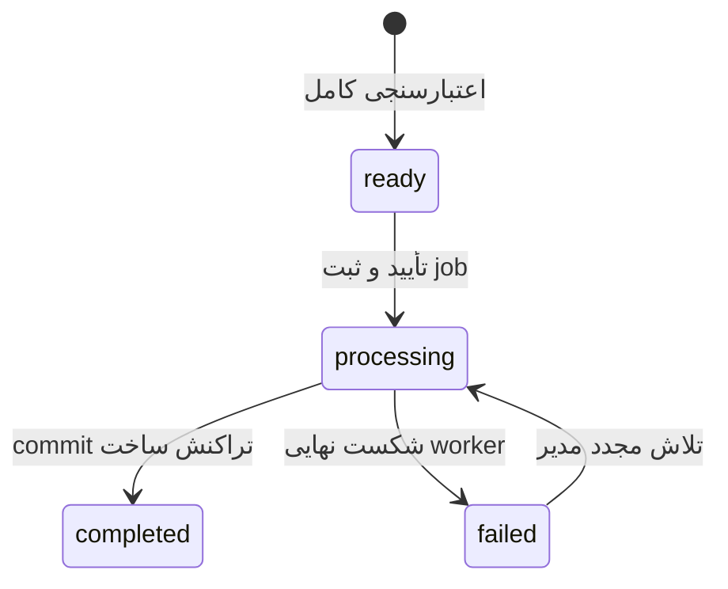

# قرارداد ورود پلی‌لیست

## فایل صوتی

POST `/api/v1/admin/media` با multipart و فیلد `audio` یک فایل را می‌پذیرد. پاسخ حاوی `data.id` از نوع UUID است. اندازه تا 100 MiB و مدت تا چهار ساعت است. پسوند و MIME بررسی و FFprobe با timeout پانزده ثانیه اجرا می‌شود. رشتهٔ فرمان با آرگومان‌های جدا ساخته می‌شود. hash محتوای فایل موجب deduplication می‌شود. صوت ویدیویی رد و تصویر کاور embedded در فایل صوتی پذیرفته می‌شود.

آپلود، asset می‌سازد؛ هنوز Track و Playlist ایجاد نمی‌کند. این جداسازی اجازهٔ اصلاح manifest و استفادهٔ مجدد از فایل‌ها را می‌دهد. پاک‌سازی فایل‌های بدون استفاده در این نسخه خودکار نیست؛ سیاست retention و پاک‌سازی امن در فاز عملیات تعریف شده است.

## قالب JSON

ریشه می‌تواند آرایه باشد یا شیء دارای `tracks`. هر ردیف فقط `asset_id`, `title`, `artist`, `album` دارد. album اختیاری است. title و artist تا 255 نویسه‌اند. نام، توضیح و mood پلی‌لیست جداگانه در فرم ارسال می‌شوند. مسیر صوت، URL خارجی و مدت دستی پذیرفته نمی‌شوند.

## قالب CSV

UTF-8، با یا بدون BOM، جداکنندهٔ کاما و quote استاندارد دوتایی. سربرگ حداقل asset_id,title,artist و album اختیاری است. ستون اضافه پذیرفته نمی‌شود. ردیف خالی نادیده گرفته می‌شود؛ تعداد ستون نامتوازن یا سربرگ تکراری خطا است. ترتیب حفظ می‌شود و فایل حداکثر 500 آهنگ دارد.

## پیش‌نمایش

POST `/api/v1/admin/imports` با فیلدهای name, description, mood, manifest و header `Idempotency-Key` انجام می‌شود. کلید 16 تا 64 نویسه از حروف/اعداد/خط‌تیره/زیرخط است؛ UUID گزینهٔ مناسبی است. همان کلید و همان payload همان import را برمی‌گردانند. payload متفاوت با همان کلید 409 می‌گیرد. محدودیت کلید در محدودهٔ مدیر است.

هیچ ردیفی از پیش‌نمایش، پلی‌لیست یا Track منتشر نمی‌کند. خطای هر ردیف به‌صورت کلید `tracks.<index>.<field>` با index صفرمبنا برمی‌گردد. وجود یک خطا کل پیش‌نمایش را رد می‌کند. ردیف معتبر snapshot می‌شود و در مرحلهٔ بعد دوباره از فایل مرورگر خوانده نمی‌شود.

## تأیید و پردازش

POST `/api/v1/admin/imports/{id}/commit` با `{publish: true|false}` وضعیت را processing و job را در همان تراکنش دیتابیس ثبت می‌کند. همان تأیید چندباره job منطقی جدید ایجاد نمی‌کند. worker روی ردیف import قفل می‌گیرد، Trackهای جدید را می‌سازد یا قبلی را بازاستفاده می‌کند، رابطه‌ها را با position ایجاد می‌کند و در پایان status را به completed می‌برد. publish=false مجموعه را draft نگه می‌دارد.

استفادهٔ دوباره از Track، عنوان یا هنرمند قبلی را تغییر نمی‌دهد؛ این نکته در report بازتاب دارد. خطای ساخت، تمام نوشته‌های ساخت را rollback می‌کند. worker سه تلاش با backoff دارد؛ پس از شکست نهایی import به failed می‌رود. پس از رفع علت، مدیر می‌تواند آن را دوباره تأیید کند. نبود worker باعث باقی ماندن processing می‌شود و باید از مسیر عملیات بررسی شود.

خطاهای SQL یا مسیر داخلی به کاربر نمایش داده نمی‌شوند؛ جزئیات در لاگ سرور است. گزارش پنل تعداد ردیف بررسی‌شده، Track تازه و Track بازاستفاده‌شده را نشان می‌دهد.

## اتصال صریح به هویت کاتالوگ، نسخهٔ 0.2

ستون‌های اختیاری `artist_id` و `release_id` باید شناسهٔ موجود همین کتابخانه باشند. در آهنگ تازه، نام نمایشی از هویت انتخاب‌شده خوانده می‌شود. اگر شناسه ندهید، هویت نیازمند بازبینی با provenance همان Track ساخته می‌شود؛ نام یکسان، دلیل ادغام نیست. Track با media_asset_id موجود دوباره ساخته یا متادیتایش بازنویسی نمی‌شود. فایل rendition نمی‌تواند به‌عنوان اصل Track تازه وارد شود. تغییر هویت Track مشترک از بخش کاتالوگ انجام می‌گیرد و روی همهٔ پلی‌لیست‌هایش اثر می‌گذارد.

تکرار فایل در یک manifest و تکرار Track در یک پلی‌لیست v1 مجاز نیست. ترتیب ردیف‌ها حفظ می‌شود. پس از ساخت می‌توان مجموعه را با revision در پنل مرتب یا بایگانی کرد.
