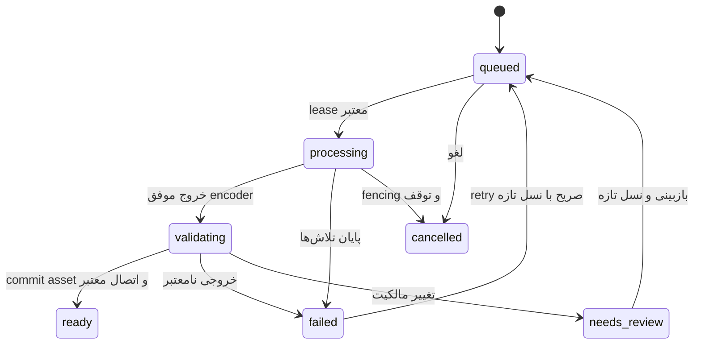

# ساختار تبدیل FLAC به MP3 320kbps

وضعیت: قرارداد هدف A03/A08، نه قابلیت فعال نسخهٔ 0.2. کد فعلی فقط upload، FFprobe و اتصال دستی rendition دارد. در این تغییر هیچ آهنگ واقعی کاربر تبدیل یا حذف نشده است. پروفایل encoder با فایل‌های مصنوعی بررسی شده؛ اتصال به Laravel، migration، worker و UI در [نقشهٔ اجرا](IMPLEMENTATION_ROADMAP.fa.md) باقی است.

## سیاست محصول و کیفیت

FLAC، master آرشیوی و MP3 با bitrate ثابت 320kbps، نسخهٔ پیش‌فرض پخش است. MP3 اتلافی است؛ با تغییر پسوند ساخته نمی‌شود و کیفیت lossless را حفظ نمی‌کند. برآورد payload صوتی 320000÷8×60 برابر 2,400,000 بایت، حدود 2.4MB یا 2.29MiB در دقیقه است؛ metadata و padding اندکی اضافه‌اند. برای یک آهنگ معمولی ممکن است بسیار کوچک‌تر از FLAC باشد، ولی نسبت فشرده‌سازی ثابت نیست و بعضی فایل‌های FLAC ساده/کوتاه حتی کوچک‌ترند.

حفظ هر دو فایل، حجم کل دیسک را کم نمی‌کند؛ حجم دانلود/پخش کمتر می‌شود. حذف master از این pipeline مجاز نیست. اگر بعداً هدف کاهش فضای اصلی باشد، باید آرشیو خارجیِ بازیابی‌شده و سیاست حذفِ مستقل با انتخاب صریح مالک تعریف شود. تبدیل دوباره از MP3، upsample برای ادعای کیفیت بیشتر، loudness normalization و downmix چندکاناله در پروفایل اولیه انجام نمی‌شوند.

## موجودیت‌ها و قیدها

| موجودیت هدف | فیلدهای اصلی و قاعده |
| --- | --- |
| media_blobs | UUID، sha256 unique، storage_key unique، bytes unsigned، MIME، probe JSON محدود، lifecycle، verified_at؛ فایل immutable و خصوصی |
| media_assets | UUID فعلی، blob_id FK، canonical_upload_blob_id nullable unique، source_asset_id nullable، ownership_revision، نام نمایشی و actor؛ مشتق و master هویت منطقی جدا دارند |
| media_conversions | UUID، source_asset_id FK، profile_id/version، source_hash و owner snapshot، status، generation، revision، lease_token/lease_expires_at، timestamps، progress_seconds، output_asset_id nullable، error_code و گزارش محدود |
| قید conversion | unique(source_asset_id, profile_id, profile_version)؛ retry همان رکورد با generation تازه؛ output فقط هنگام ready ثبت شود |
| media_storage_reservations | UUID، conversion/upload/attempt، max_bytes، lease و state؛ فضای موقت و orphan هم تا حذف واقعی حساب شوند |
| track_media | هر asset فقط یک recording؛ label mp3-cbr-320-v1 در Track یکتا؛ derivative اصل جدید Track دیگری نمی‌شود |

دو خروجیِ بایت‌یکسان می‌توانند یک blob و دو asset معنایی داشته باشند. unique SHA فعلیِ media_assets نباید با insertOrIgnore، هویت ضبط‌ها را یکی کند. مهاجرت لایهٔ blob و سازگاری v1 در [معماری هدف](ARCHITECTURE_TARGET.fa.md) تعریف شده؛ قبل از ورود مشتق‌های خودکار انجام شود. برای asset حاصل از آپلود canonical، canonical_upload_blob_id=blob_id و برای مشتق تولیدشده null؛ این منشأ با purpose ارتباط Track یکسان نیست. CHECK و unique nullable و FKها enforce شوند. مسیر blob، filename اصلی یا stdout/stderr خام در Resource عمومی قرار نگیرند؛ نام نمایشیِ پاک‌سازی‌شده فقط در Resource مدیریتی مجاز است.

تبدیل می‌تواند پیش از ساخت Track، از asset آپلودشده شروع شود. بنابراین وجود track_id شرط ایجاد conversion نیست؛ source_asset_id مرجع ثابت است. output آمادهٔ بدون Track هنوز عمومی نیست و lineage خود را نگه می‌دارد. Action ثبت recording هنگام ساخت Track، master و derivativeهای ready همان source را با مالکیت معتبر متصل می‌کند. تبدیل Track موجود در پایان، مالک اصل و snapshot مورد انتظار را دوباره می‌سنجد؛ assetی که در این فاصله rendition ضبط دیگری شده، منتشر نمی‌شود.

## پروفایل نسخه‌دار

| تنظیم | mp3-cbr-320-v1 |
| --- | --- |
| ورودی | codec واقعی flac و container مجاز؛ مدت مثبت و حداکثر 14400s؛ فقط mono/stereo |
| encoder | FFmpeg با libmp3lame؛ build و نسخه در محیط deploy pin و در گزارش ثبت شوند |
| bitrate | 320000bps، CBR؛ -b:a 320k و -abr 0؛ بدون -q:a یا VBR |
| sample rate | حفظ 44100/48000Hz؛ بقیه به 44100Hz با resampling واقعی |
| channels | حفظ ۱ یا ۲؛ چندکاناله با پیام نیاز به پروفایل صریح رد شود |
| metadata | انتخاب نخستین audio stream؛ حذف ویدیو، subtitle، data، chapter و metadata ورودی؛ کاور جدا از MP3 |
| خروجی | audio/mpeg، MP3، ID3v2.3 و Xing؛ filename و key از سرور |
| تغییر پروفایل | هر تغییر رفتاری یا build تأییدشدهٔ encoder، version جدید و re-encode صریح؛ فایل ready قبلی overwrite نشود |

آرگومان‌های هدف adapter زیرند؛ input_path و staging_path فقط از storage امن سرور حل می‌شوند. این آرایه تنظیمات قابل ارسال از مرورگر نیست. انتخاب -f flac برای ورودی از codec تأییدشده می‌آید؛ URL، playlist یا codec دلخواه کاربر پذیرفته نمی‌شود.

```json
[
  "ffmpeg", "-hide_banner", "-loglevel", "error", "-nostdin", "-n",
  "-protocol_whitelist", "file,pipe", "-f", "flac", "-i", "{input_path}",
  "-map", "0:a:0", "-map_metadata", "-1", "-map_chapters", "-1",
  "-vn", "-sn", "-dn", "-c:a", "libmp3lame", "-b:a", "320k", "-abr", "0",
  "-ar", "{sample_rate_hz}", "-ac", "{channels}", "-threads", "1",
  "-id3v2_version", "3", "-write_xing", "1", "-f", "mp3", "{staging_path}"
]
```

Symfony Process با argv جدا، process timeout و output محدود استفاده شود؛ shell، exec رشته‌ای، نام فایل کاربر در دستور و فلگ سفارشی UI وجود نداشته باشد. برای پیشرفت، -progress pipe:1/-nostats با parser محدود و throttled اضافه شود؛ stdout/stderr نباید نامحدود در حافظه یا log جمع شوند. به‌روزرسانی progress با lease_token/generation جاری و بدون نگه‌داشتن قفل سراسری انجام شود. درصد تا اتمام validation فقط تخمین است و در UI همین‌طور برچسب بخورد.

## چرخهٔ اجرا و انتشار امن



۱. upload با MIME و probe واقعی بررسی می‌شود؛ source immutable و fingerprint دارد. ثبت conversion خودکار FLAC طبق تنظیم محصول، reservation و job در همان تراکنش DB انجام می‌شود. سقف صف و فضای ناکافی پیش از پذیرش کار بررسی شوند. master و planهای معتبر از GC محافظت می‌شوند.

۲. worker در تراکنش کوتاه، state/generation را claim و lease_token تصادفی ثبت می‌کند. مجوز media.manage و وضعیت فعال actor تازه بررسی می‌شود؛ برای اتصال کاتالوگ، catalog.manage نیز لازم است. مسیر master با PrivateMedia و realpath محدود حل و fingerprint بررسی می‌شود. فایل symlink یا خروج از root مجاز نیست. parent/root در دسترس نوشتن کاربر سیستم دیگری نباشد.

۳. FFmpeg بیرون تراکنش، در process group قابل توقف و با یک کار سنگین همزمان اجرا می‌شود. هر attempt مسیر staging یکتای خودش را دارد؛ -n مانع overwrite است. پایان صفر process به‌تنهایی کافی نیست: bytes مثبت، codec=mp3، stream bitrate=320000، sample rate/channels مطابق profile، مدت با اختلاف حداکثر 0.25s و full decode بدون خطا سنجیده شوند. validation timeout و decoder budget جداگانه محدود باشند؛ فایل ناقص، صفر بایت یا overflow هرگز ready نیست.

۴. خروجی در همان filesystem به key immutable یکتا منتقل می‌شود. سپس در تراکنش، generation/lease، source hash، مالکیت، مجوز actor و reservation دوباره بررسی شوند. blob آمادهٔ با همان hash می‌تواند بازاستفاده شود؛ asset منطقی متعلق به recording دیگر بازاستفاده نشود. blob/asset/lineage و اتصال اختیاری track_media، وضعیت ready، مصرف quota و audit اتمیک commit شوند. خروجی تکراری فیزیکی تا پاک‌شدن همچنان در حساب فضای مصرف‌شده/رزرو می‌ماند.

۵. crash پس از نوشتن فایل و قبل از commit فقط orphan محافظت‌شده می‌سازد. خطای مبهم commit باعث حذف فوری فایل نشود. GC پس از retention، نبود ارجاع فعال/plan/backup و پایان attempt را تأیید کند. blob با حالت deleting دوباره claim نمی‌شود. شکست cleanup به retry cleanup منجر می‌شود؛ asset آماده یا master را حذف نمی‌کند. تلاش قدیمی اجازهٔ تغییر state یا حذف خروجی نسل جدید را ندارد.

در زمان نهایی، لغو یا ابطال دسترسی actor باید مؤثر باشد؛ مجوز قبلیِ enqueue کافی نیست. اصل و خروجی ready هیچ‌وقت درجا جایگزین نمی‌شوند. re-encode پروفایل تازه، اشاره‌گر پیش‌فرض را بعد از آماده‌شدن تغییر می‌دهد؛ درخواست stream قدیمی می‌تواند به انتقال بایت فعلی ادامه دهد و revocation آنیِ بایت‌های ارسال‌شده تضمین نمی‌شود.

## صف، timeout و resource budget

| پارامتر هدف اولیه | مقدار و محدودیت |
| --- | --- |
| SQL queue | connection تنظیمات media_database با همان SQL connection برنامه؛ table jobs، queue=media |
| worker | یک پردازش سنگین؛ import queue مستقل؛ تعداد پس از اندازه‌گیری تغییر کند |
| FFmpeg timeout | 600s؛ timeout validation حداکثر 30s؛ job timeout=660s |
| retry_after | 900s برای connection رسانه؛ default import فعلی 180s جدا بماند |
| lease | 960s، heartbeat هر 10s؛ fencing در همهٔ updateها |
| supervisor stopwaitsecs | حداقل 720s؛ stopasgroup/killasgroup؛ stop/restart باید child را نیز متوقف کند |
| retry | حداکثر ۳ تلاش transient با backoff؛ codec نامعتبر، snapshot conflict یا مجوز لغوشده کورکورانه retry نشوند |
| ظرفیت | سقف 20 conversion غیرنهایی در کل کتابخانه، یک worker اولیه؛ رفتار busy با 429 و Retry-After |

این زمان‌ها بودجهٔ اولیه‌اند؛ فایل ۴ساعته روی سخت‌افزار ضعیف ممکن است در بودجه جا نشود. چنین فایلی fail قابل‌فهم می‌گیرد؛ ادعای تضمین زمان تبدیل نداریم. تنظیم timeout، retry_after، lease و stopwait باید با هم و با تست توقف process تغییر کنند. DB connection رسانه صرفاً تنظیم queue جداست؛ انتقال به DB دیگر یا Redis، مرز اتمیک فعلی را از بین می‌برد و طراحی تحویل جدید می‌خواهد.

quota پیش از پردازش، اندازهٔ برآوردشدهٔ مشتق را با `ceil(duration×40000×1.02)+1048576` رزرو می‌کند؛ خروجی بیش از 600MiB رد شود. سقف‌های هدف قابل تنظیم: upload اصل FLAC حداکثر 512MiB، در برابر 100MiB فعلی؛ حداکثر مدت فعلی ۴ ساعت باقی می‌ماند. این افزایش تا A08 فعال نیست. post_max_size و Nginx body limit برای multipart حداقل 544MiB و upload_max_filesize حداقل 512MiB تنظیم و در staging بررسی شوند. کل quota و minimum free space از ظرفیت واقعی میزبان تعیین می‌شوند؛ بدون آن، تبدیل production فعال نشود.

انقضای lease به‌تنهایی دلیل آزادکردن فضا نیست؛ process قدیمی و فایل موقت باید fence/متوقف یا با شاهد معتبر پاک شده باشند. ledger و disk usage به‌صورت دوره‌ای تطبیق و اختلاف گزارش شود. پردازش غیرroot، filesystem خصوصی و محدودیت CPU/memory/temp در سرویس worker اعمال شوند. نسخهٔ FFmpeg و libmp3lame هم بخشی از به‌روزرسانی امنیت و manifest deploy هستند.

## APIهای برنامه‌ریزی‌شده؛ هنوز route اجرایی نیستند

| method/path | قرارداد و مجوز |
| --- | --- |
| GET /api/v1/admin/media-policy | اندازه/مدت/profile و quota قابل نمایش؛ media.manage؛ بدون env یا path |
| PUT /api/v1/admin/media/{asset}/conversions/{profile} | ایجاد idempotent منطقی براساس source/profile/version؛ source_revision و profile_version؛ media.manage و برای اتصال catalog.manage؛ step-up |
| GET /api/v1/admin/media-conversions | cursor/filter؛ گزارش محدود و actor مجاز |
| GET /api/v1/admin/media-conversions/{conversion} | state، generation، revision، progress تخمینی و report |
| POST /api/v1/admin/media-conversions/{conversion}/retry | expected_generation/revision؛ فقط حالت مجاز و نسخهٔ تازه؛ step-up |
| POST /api/v1/admin/media-conversions/{conversion}/cancel | expected_generation/revision؛ fencing، توقف و cleanup؛ step-up |

PUT تکراری همان resource را برمی‌گرداند؛ job دوم نمی‌سازد و failed را خودکار retry نمی‌کند. 202 برای queued، 200 برای resource موجود، 409 برای snapshot/generation یا media_not_ready، 422 برای ورودی/profile نامعتبر، 429 برای صف پر و 507 برای quota/free-space ناکافی است. به 507 پیام محصول داده شود؛ path یا stderr خام نمایش داده نشود. خطای API، code ثابت و request_id دارد؛ ترجمه فقط message را تغییر می‌دهد. OpenAPI اجرایی فعلی تا ساخت routeها به‌دروغ توسعه داده نمی‌شود.

آدرس فعلی `/api/v1/tracks/{track}/stream` حفظ می‌شود؛ Laravel پس از Policy، MP3 آماده را انتخاب و MIME/Range/ETag همان نسخه را ارائه می‌کند. تغییر پروفایل، ETag را عوض می‌کند. اصل FLAC به‌طور خودکار از URI عمومی دیسک ارائه نمی‌شود. انتشار پیش‌فرض playlist دارای FLAC به profile MP3 آماده نیاز دارد: preview وضعیت تبدیل را نشان می‌دهد، commit پیش از آمادگی 409 media_not_ready می‌دهد، و gate نهایی job مجدداً آن را می‌سنجد. FFmpeg داخل تراکنش انتشار اجرا نمی‌شود. ساخت پیش‌نویس با وضعیت «در انتظار رسانه» در UI ممکن است، ولی برای شنونده منتشر نمی‌شود.

## پنل و معیار پذیرش

UploadQueue پیشرفت واقعی هر فایل، خطا، تکراری‌بودن و quota را نشان دهد. ImportPreviewTable برای هر ردیف source format، profile پخش، وضعیت آماده‌شدن و متادیتای resolved را نمایش دهد. ConversionPanel فهرست قابل فیلتر، تخمین bytes و مدیریت retry/cancel دارد؛ اقدام گروهی محدود و نتیجهٔ هر مورد جداست. FLAC اصلی، MP3 خروجی، حجم‌ها و هشدار اتلافی‌بودن واضح باشند. وضعیت 100٪ فقط پس از validation/commit موفق است. همهٔ اجزا RTL/LTR، روشن/تیره، keyboard و screen reader را پوشش دهند.

تست‌های لازم: mono/stereo و high sample rate؛ فایل خراب/ناقص/ویدیو؛ rejection چندکاناله؛ source ownership عوض‌شده؛ duplicate dispatch و output hash یکسان برای دو Track؛ crash قبل/بعد از commit؛ حذف ناموفق؛ quota و temp پر؛ worker kill؛ generation قدیمی؛ revoke actor؛ decode کامل؛ Range/HEAD/416 و عدم دسترسی مستقیم؛ حفظ FLAC و Track ID/likes/playlist. تست queue/DB باید روی MySQL واقعی و بدون outer transaction پنهان‌کنندهٔ afterCommit نیز اجرا شود.

آزمایش محلی این بررسی: FFmpeg 6.1.1 با libmp3lame، سه fixture مصنوعی ۳ثانیه‌ای؛ نرخ stream هر سه 320000، مدت‌های 3.030204/3.024/3.030204s، full decode موفق. این آزمایش کیفیت شنیداری، پایداری job یا throughput را ثابت نمی‌کند. گزارش در [verification](verification/architecture-review-2026-10-27.json) است. مرجع encoder: [FFmpeg libmp3lame](https://ffmpeg.org/ffmpeg-codecs.html#libmp3lame)، مرجع اجرای امن process: [Symfony Process](https://symfony.com/doc/current/components/process.html). انتخاب‌های lifecycle، quota و پروفایل، قرارداد همین محصول‌اند.
